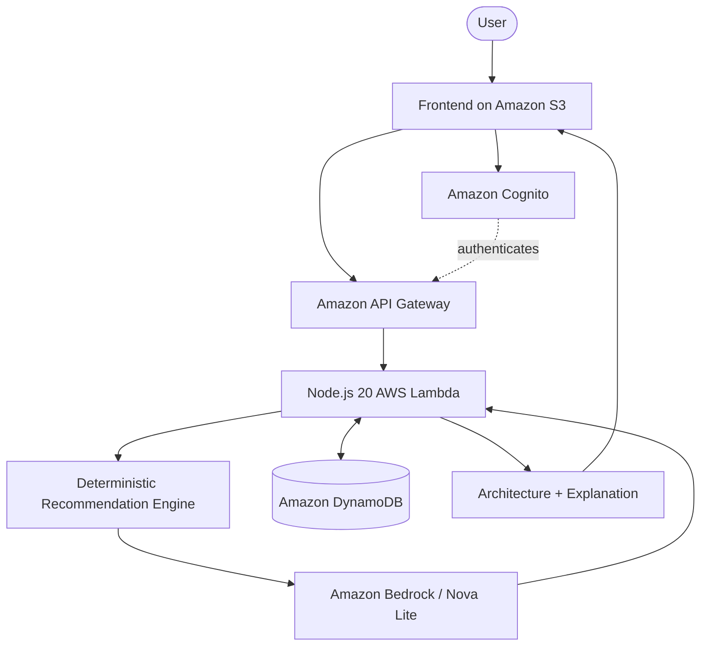

<p align="center">
  
</p>

<p align="center">
  
</p>

<p align="center">
  <strong>From application requirements to explainable AWS architecture recommendations.</strong>
</p>

<p align="center">
  <code>AI-POWERED</code> &nbsp; <code>AWS</code> &nbsp; <code>NODE.JS 20</code> &nbsp; <code>AMAZON BEDROCK</code> &nbsp; <code>SERVERLESS</code>
</p>

---

## ◈ 01 — The mission

**CloudArchitect AI** turns application requirements into structured AWS architecture recommendations.

Describe the application you want to build—its workload, budget, database preference, availability needs and authentication requirements. The platform evaluates those inputs, selects suitable AWS services using a deterministic recommendation engine, and uses **Amazon Bedrock / Amazon Nova Lite** to explain the resulting design.

> The recommendation engine selects the services. Bedrock explains the design; it does not independently choose the services.

## ◈ 02 — What it can do

| Capability | What it does |
|---|---|
| Architecture recommendations | Selects AWS services based on application requirements and implemented rules |
| AI explanations | Uses Amazon Bedrock to explain the selected architecture, with a fallback explanation |
| Architecture visualization | Displays service cards and an architecture flow |
| Architecture inspector | Shows service purpose, selection rationale and design-level connection hints |
| Cost classification | Presents a qualitative Low / Medium / High category and its cost drivers |
| Authentication | Supports sign-up, email verification, sign-in and sign-out through Amazon Cognito |
| Saved history | Stores and retrieves user-specific recommendations with DynamoDB |
| Compare designs | Compares previously saved recommendations |
| Export | Exports recommendation data as JSON and the graph as PNG/SVG |

## ◈ 03 — Technology stack

| Layer | Technology |
|---|---|
| Frontend | HTML5, CSS3, JavaScript |
| Backend | Node.js 20, AWS Lambda |
| AI explanation | Amazon Bedrock, Amazon Nova Lite |
| API | Amazon API Gateway |
| Authentication | Amazon Cognito |
| Persistence | Amazon DynamoDB |
| Infrastructure | AWS SAM, CloudFormation |
| Frontend hosting | Amazon S3 |
| Monitoring | Amazon CloudWatch |

## ◈ 04 — Architecture at a glance



## ◈ 05 — How a recommendation is created

1. **Describe** — Enter the application type, expected users, budget, database, availability and authentication needs.
2. **Evaluate** — The recommendation engine applies the project's architecture rules.
3. **Explain** — Bedrock generates a contextual explanation for the selected design.
4. **Explore** — Inspect service cards and the architecture flow; drag nodes, pan and zoom the graph.
5. **Save** — Store the recommendation in your authenticated history.
6. **Compare and export** — Compare saved designs or export the recommendation and diagram.

## ◈ 06 — Project structure

```text
CloudArchitect-AI-Improved/
├── backend/
│   ├── app.js
│   ├── recommendationEngine.js
│   ├── recommendationEngine.test.js
│   └── package.json
├── frontend/
│   ├── index.html
│   ├── styles.css
│   ├── app.js
│   └── config.js
├── scripts/
│   ├── deploy.sh
│   ├── deploy.ps1
│   └── write_config.py
├── template.yaml
└── README.md
```

## ◈ 07 — Run locally

### Prerequisites

- Python 3 (for the local static server)
- Node.js 20+ and npm (for backend tests)
- AWS CLI and AWS SAM CLI (for deployment)
- An AWS account with the required permissions
- Amazon Nova Lite access in the selected AWS region

### Start the frontend locally

From the extracted project directory:

```powershell
py -m http.server 8000 --directory frontend
```

Open [http://localhost:8000](http://localhost:8000).

The checked-in `frontend/config.js` contains `REPLACE_...` configuration markers. The interface can be previewed locally, but authentication and API-backed features require valid Cognito and API Gateway configuration.

### Install backend dependencies and run tests

```bash
npm --prefix backend install --omit=dev
node backend/recommendationEngine.test.js
```

## ◈ 08 — Deploy to AWS

### macOS / Linux

```bash
chmod +x scripts/deploy.sh
./scripts/deploy.sh cloudarchitect-ai
```

### Windows PowerShell

```powershell
.\scripts\deploy.ps1 -StackName cloudarchitect-ai -Region us-east-1
```

The deployment script deploys the SAM stack, writes generated configuration into the frontend and uploads the frontend to the S3 bucket. Open the frontend URL printed by the script after deployment.

## ◈ 09 — Recommendation rules

The current engine applies rules such as:

- Fundamentals: S3, API Gateway and CloudWatch.
- Small/medium workloads: AWS Lambda.
- Larger workloads: ECS Fargate with an Application Load Balancer.
- Relational data: RDS / Aurora.
- NoSQL data: DynamoDB.
- Requested authentication: Amazon Cognito.
- Medium/large traffic or high availability: CloudFront.
- High availability: Route 53.

These are implemented recommendation rules, not a universal substitute for production architecture review.

## ◈ 10 — Important boundaries

- This is an educational architecture recommendation prototype, not an automatic production infrastructure generator.
- It recommends a design; it does **not** provision every recommended workload resource such as RDS, Fargate or CloudFront for the hypothetical application.
- Cost categories are qualitative. The project does not calculate exact AWS prices or call the AWS Pricing API.
- Diagram connection hints describe intended relationships; they do not prove that resources exist or are connected in a live AWS account.
- If Bedrock invocation is unavailable, the application can use its deterministic fallback explanation.

## ◈ 11 — Built by

<p align="center">
  
</p>

<p align="center">
  <a href="https://github.com/adarshmuchatte-lang">GitHub profile: adarshmuchatte-lang</a>
</p>

<p align="center">
  
</p>

<p align="center"><strong>DESIGN INTELLIGENTLY. BUILD RESPONSIBLY. SCALE WITH THE CLOUD.</strong></p>
