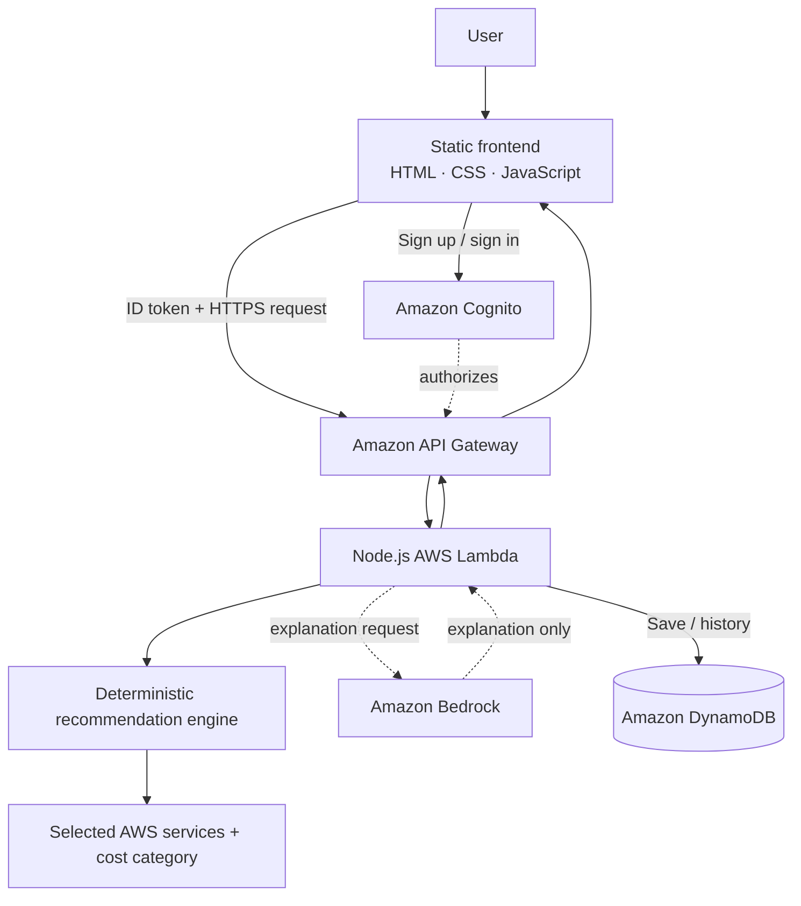

[Uploading README (9).md…]()
<div align="center">


# CLOUDARCHITECT AI

### DESIGN THE CLOUD. INTELLIGENTLY.

**An explainable AWS architecture recommendation studio.**  
Deterministic rules choose the services. Amazon Bedrock can explain the recommendation.

[Explore the 3D showcase](docs/3d-showcase/index.html) · [Architecture diagram](assets/readme/architecture.png) · [Deployment template](template.yaml)

</div>

---

## The vision

CloudArchitect AI turns a small set of workload requirements into a readable, explainable AWS architecture recommendation. It is designed to make early architecture decisions easier to explore—not to pretend that a generated diagram is a production-ready deployment.

The project separates **service selection** from **natural-language explanation**:

- A deterministic recommendation engine selects services from workload inputs and explicit rules.
- Amazon Bedrock is an explanation layer only; its response does not change the selected services.
- If Bedrock is unavailable, the backend can return a deterministic fallback explanation.
- The app classifies relative cost as **Low**, **Medium**, or **High**. This is a qualitative category, not a live AWS pricing estimate.

<div align="center">
  
  <sub>Hero artwork · static fallback for the animated preview above</sub>
</div>

## What is implemented

<div align="center">
  
</div>

| Capability | Current implementation |
|---|---|
| Architecture recommendations | Rule-based service selection in `backend/recommendationEngine.js` |
| AI explanation | Optional Amazon Bedrock invocation; configured model defaults to Amazon Nova Lite |
| Fallback explanation | Deterministic explanation if Bedrock cannot be used |
| Authentication | Amazon Cognito sign-up, email verification, sign-in and sign-out |
| API protection | API Gateway Cognito authorizer |
| Saved history | Per-user recommendation persistence in DynamoDB |
| Architecture graph | Interactive frontend graph with node inspection, pan and zoom |
| Cost category | Relative Low / Medium / High classification |
| Graph export | PNG and SVG exports |
| Infrastructure | AWS SAM / CloudFormation template and Bash / PowerShell deployment scripts |
| Tests | Node.js assertions for core recommendation rules |

The feature list intentionally describes the supplied source code, not a speculative roadmap. JSON export, live cost estimation, one-click provisioning of recommended workloads, and a design-comparison workflow are **not** claimed as implemented here.

## Technology constellation

<div align="center">
  
</div>

- **Frontend:** HTML5, CSS3, vanilla JavaScript
- **Backend:** Node.js 20 AWS Lambda
- **API:** Amazon API Gateway (REST API)
- **Identity:** Amazon Cognito User Pools
- **Persistence:** Amazon DynamoDB
- **AI explanation:** Amazon Bedrock (model configurable through `BedrockModelId`, default `amazon.nova-lite-v1:0`)
- **Infrastructure:** AWS SAM and AWS CloudFormation
- **Static hosting:** Amazon S3 website endpoint
- **Developer tooling:** AWS CLI, AWS SAM CLI, npm, Bash or PowerShell

## System architecture

<div align="center">
  
  
</div>

### Request flow



**Important distinction:** the services shown inside a generated recommendation are output suggestions. The deployment stack provisions the CloudArchitect AI application itself; it does not provision every service recommended for a hypothetical workload.

## How it works

1. The user creates an account, verifies the email address and signs in through Cognito.
2. The frontend sends application type, expected users, budget priority, database preference, availability requirement and authentication preference to the API.
3. API Gateway validates the Cognito identity token before invoking Lambda.
4. The deterministic engine selects a service set and a qualitative cost category.
5. Bedrock may generate a human-readable explanation of that result. It is not the decision engine.
6. The user can inspect the returned architecture graph and export the graph as PNG or SVG.
7. Saved recommendations are written to DynamoDB under the user's identity and can be retrieved through History.

## Repository map

```text
CloudArchitect-AI/
├── README.md
├── template.yaml                    # AWS SAM / CloudFormation resources
├── backend/
│   ├── app.js                        # Lambda handler, API routes, Bedrock and history
│   ├── recommendationEngine.js       # Deterministic selection rules
│   ├── recommendationEngine.test.js  # Rule-engine assertions
│   └── package.json
├── frontend/
│   ├── index.html                    # Application markup
│   ├── styles.css                    # Application styling
│   ├── app.js                        # Auth, API calls, graph, exports and history
│   └── config.js                     # Deployment-generated frontend configuration
├── scripts/
│   ├── deploy.sh                     # macOS / Linux deployment
│   ├── deploy.ps1                    # Windows PowerShell deployment
│   └── write_config.py               # Writes CloudFormation outputs to config.js
├── assets/
│   └── readme/
│       ├── hero.gif
│       ├── hero.png
│       ├── hero.svg
│       ├── architecture.gif
│       ├── architecture.png
│       ├── architecture.svg
│       ├── features.png
│       ├── features.svg
│       ├── technology.png
│       └── technology.svg
└── docs/
    └── 3d-showcase/
        └── index.html                # Standalone interactive CSS 3D showcase
```

## Run locally

### Requirements

- Node.js 20 or newer and npm
- Python 3 for helper scripts if needed
- AWS CLI and AWS credentials for deployment
- AWS SAM CLI for validating, building and deploying the stack

### Check the recommendation engine

From the repository root:

```bash
npm --prefix backend install
node backend/recommendationEngine.test.js
```

The test file uses Node's built-in `assert` module; no separate test runner is required.

### Preview the frontend

The frontend is a static site. From the repository root, start a simple local server:

```bash
python -m http.server 8000 --directory frontend
```

Then open `http://localhost:8000`.

The application needs valid Cognito pool IDs, a client ID and an API URL in `frontend/config.js` to authenticate and call the backend. A local static preview without deployed/configured AWS resources can show the interface, but sign-in and recommendation requests will not work. **Do not commit real credentials or account-specific configuration.**

## Deploy to AWS

The provided scripts deploy the SAM stack, read CloudFormation outputs, write the generated frontend configuration, and sync the frontend to the S3 website bucket.

### macOS / Linux

```bash
chmod +x scripts/deploy.sh
./scripts/deploy.sh cloudarchitect-ai
```

Set `AWS_REGION` first if you want a region other than the script's default `us-east-1`.

### Windows PowerShell

```powershell
.\scripts\deploy.ps1 -StackName cloudarchitect-ai -Region us-east-1
```

### Prerequisites and notes

1. Configure the AWS CLI for the intended account and region.
2. Install AWS SAM CLI and Node.js 20+.
3. Ensure the deployer can create/manage the resources in `template.yaml`, including IAM roles/policies, Lambda, API Gateway, Cognito, DynamoDB and S3.
4. Review Amazon Bedrock model access and regional availability. If invocation is unavailable, the app is designed to fall back to a deterministic explanation.
5. Review the generated stack, costs and security posture before using it outside a demo.

The deployment currently publishes the static frontend through an **HTTP S3 website endpoint** and configures public object reads for the website. This is a demo-oriented setup, not a production hosting recommendation. For production, use an HTTPS delivery layer such as CloudFront, tighten CORS to the real origin, review IAM permissions, and apply a full security review before exposing the application.

To remove the deployed stack, first review the resources and data you intend to retain, then delete the CloudFormation stack from the AWS console or CLI. DynamoDB history and other resources may be deleted with the stack; back up anything you need first.

## Demo walkthrough

1. Open the frontend URL printed by the deployment script.
2. Create an account and verify the email address.
3. Sign in.
4. Enter the workload requirements and generate a recommendation.
5. Select service nodes to inspect their rationale.
6. Export the architecture graph as PNG or SVG.
7. Save a recommendation and open **History** to show user-scoped persistence.
8. Open [`docs/3d-showcase/index.html`](docs/3d-showcase/index.html) locally for the standalone interactive visual experience.

## Visual assets and GitHub rendering

GitHub README content does not execute custom JavaScript, CSS or WebGL. The hero and architecture animations are pre-rendered GIFs; the PNGs are static fallbacks. The standalone showcase is a separate HTML document and is not embedded as an interactive scene inside GitHub's README.

All README visuals are stored locally in `assets/readme/`, so the README does not depend on external image hosts.

## Limitations

- Recommendations are rule-based and reflect the rules currently encoded in `recommendationEngine.js`.
- The Low / Medium / High cost category is qualitative; there is no live AWS Pricing API estimate.
- Bedrock explains a recommendation and does not select or provision services.
- The app does not automatically deploy the hypothetical architecture it recommends.
- History persists saved recommendations; it is not a full version-control or design-comparison system.
- The included S3 website hosting uses HTTP and should be hardened before production use.
- The standalone 3D showcase is a conceptual visualization, not a live AWS resource map.
- The supplied test file covers core rule-engine assertions, not end-to-end AWS deployment or browser integration.

## Developer

<div align="center">

**ADARSH MUCHATTE**  
Information Technology Student · VIT Vellore

[GitHub · @adarshmuchatte-lang](https://github.com/adarshmuchatte-lang)

<sub>BUILD WITH CLARITY · DESIGN WITH INTENT · ENGINEER FOR REALITY</sub>

</div>

---

<div align="center">
  <sub>CLOUDARCHITECT AI · ARCHITECTURE DECISION SUPPORT, MADE EXPLAINABLE.</sub>
</div>
