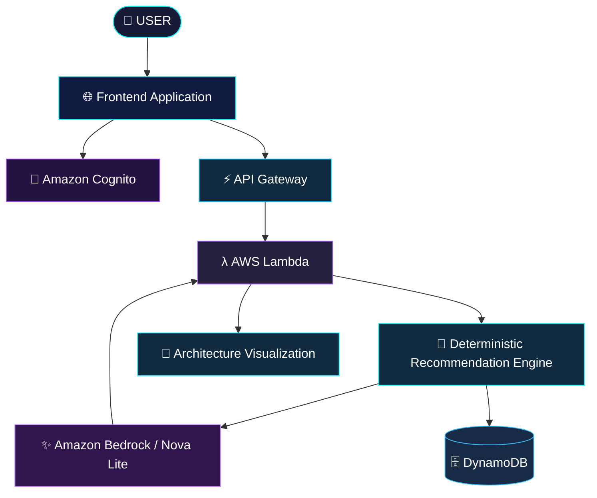

  # ☁️ CLOUDARCHITECT AI

<p align="center">
  
</p>

<p align="center">
  
</p>

<p align="center">
  
  
  
  
</p>

<p align="center">
  <b>⚡ From application requirements to intelligent cloud architecture. ⚡</b>
</p>

---

## ◈ 01 — THE VISION

> What if designing cloud infrastructure was as simple as describing an idea?

**CloudArchitect AI** is an AI-powered AWS architecture recommendation platform that transforms application requirements into structured cloud architecture designs.

It combines deterministic infrastructure selection with the intelligence of **Amazon Bedrock (Amazon Nova Lite)** to explain architectural decisions.

No random service selection. No guessing.

Just structured recommendations, intelligent explanations and interactive architecture visualization.

<p align="center">
  
</p>

## ◈ 02 — SYSTEM CAPABILITIES

<table>
<tr>
<td align="center" width="50%">
<h3>🤖 AI INTELLIGENCE</h3>
Amazon Bedrock integration for contextual architecture explanations.
</td>
<td align="center" width="50%">
<h3>🏗️ ARCHITECTURE ENGINE</h3>
Rule-based AWS service selection based on application requirements.
</td>
</tr>
<tr>
<td align="center">
<h3>🌐 VISUAL ARCHITECTURE</h3>
Interactive architecture graph with draggable nodes, zoom and pan.
</td>
<td align="center">
<h3>💎 COST INTELLIGENCE</h3>
Qualitative Low / Medium / High cost classification and cost drivers.
</td>
</tr>
<tr>
<td align="center">
<h3>🔐 SECURE IDENTITY</h3>
Amazon Cognito authentication and email verification.
</td>
<td align="center">
<h3>📚 CLOUD MEMORY</h3>
User-specific recommendation history using DynamoDB.
</td>
</tr>
<tr>
<td align="center">
<h3>⚔️ ARCHITECTURE COMPARISON</h3>
Compare previously saved architecture recommendations.
</td>
<td align="center">
<h3>📡 MULTI-FORMAT EXPORT</h3>
Export architecture as PNG, SVG and JSON.
</td>
</tr>
</table>

---

## ◈ 03 — THE TECHNOLOGY UNIVERSE

<p align="center">
  
</p>

| SYSTEM LAYER | TECHNOLOGY |
|:---|:---|
| Frontend | HTML5, CSS3, JavaScript |
| Backend | Node.js 20 |
| AI Intelligence | Amazon Bedrock |
| Foundation Model | Amazon Nova Lite |
| Authentication | Amazon Cognito |
| API Gateway | Amazon API Gateway |
| Compute | AWS Lambda |
| Database | Amazon DynamoDB |
| Infrastructure | AWS SAM / CloudFormation |
| Hosting | Amazon S3 |
| Monitoring | Amazon CloudWatch |

---

## ◈ 04 — INSIDE THE ARCHITECTURE

<p align="center">
  
</p>



### ⚡ THE INTELLIGENCE PIPELINE

**01 — INPUT**

The user describes their application requirements, workload, budget, database preferences and availability.

**02 — ANALYSIS**

The deterministic recommendation engine evaluates the requirements and selects suitable AWS services.

**03 — AI EXPLANATION**

Amazon Bedrock explains the selected architecture. The AI explains the design; it does not independently select the services.

**04 — VISUALIZATION**

The platform generates an interactive architecture flow with service details and connection hints.

**05 — PERSISTENCE**

Recommendations can be saved and retrieved through authenticated DynamoDB-backed history.

---

## ◈ 05 — THE ARCHITECTURE ENGINE

The recommendation engine follows structured rules:

| REQUIREMENT | ARCHITECTURAL CHOICE |
|:---|:---|
| Fundamentals | S3 + API Gateway + CloudWatch |
| Small / Medium Workloads | AWS Lambda |
| Large Workloads | ECS Fargate + ALB |
| Relational Database | RDS / Aurora |
| NoSQL Database | DynamoDB |
| User Authentication | Amazon Cognito |
| Medium / Large Traffic | CloudFront |
| High Availability | CloudFront + Route 53 |

The architecture engine makes deterministic service selections, while Amazon Bedrock adds contextual explanations.

---

## ◈ 06 — PROJECT STRUCTURE

```text
CLOUDARCHITECT-AI/
│
├── 📁 backend/
│   ├── app.js
│   ├── recommendationEngine.js
│   ├── recommendationEngine.test.js
│   └── package.json
│
├── 📁 frontend/
│   ├── index.html
│   ├── styles.css
│   ├── app.js
│   └── config.js
│
├── 📁 scripts/
│   ├── deploy.sh
│   ├── deploy.ps1
│   └── write_config.py
│
├── template.yaml
└── README.md
```

---

## ◈ 07 — DEPLOYMENT PROTOCOL

### Requirements

- Node.js 20+
- AWS CLI
- AWS SAM CLI
- Configured AWS account and IAM permissions
- Amazon Bedrock model access in the selected region

### STEP 01 — Clone the repository

```bash
git clone https://github.com/YOUR_USERNAME/cloudarchitect-ai.git

cd cloudarchitect-ai
```

### STEP 02 — Install dependencies

```bash
npm --prefix backend install --omit=dev
```

### STEP 03 — Run tests

```bash
node backend/recommendationEngine.test.js
```

### STEP 04 — Deploy the infrastructure

**Windows PowerShell**

```powershell
.\scripts\deploy.ps1 -StackName cloudarchitect-ai -Region us-east-1
```

**Linux / macOS**

```bash
chmod +x scripts/deploy.sh
./scripts/deploy.sh cloudarchitect-ai
```

### STEP 05 — Launch

Open the frontend URL printed by the deployment script, register your account, verify your email and generate your first architecture.

---

## ◈ 08 — PROJECT DEMONSTRATION

<p align="center">
  
</p>

The demonstration workflow:

```text
[ CREATE ACCOUNT ]
        |
        ▼
[ ENTER REQUIREMENTS ]
        |
        ▼
[ GENERATE RECOMMENDATION ]
        |
        ▼
[ EXPLORE AWS SERVICES ]
        |
        ▼
[ VISUALIZE ARCHITECTURE ]
        |
        ▼
[ SAVE & COMPARE ]
        |
        ▼
[ EXPORT DESIGN ]
```

---

## ◈ 09 — ENGINEERING BOUNDARIES

CloudArchitect AI is an educational architecture recommendation prototype.

- It recommends infrastructure but does not automatically provision every resource in the hypothetical application architecture.
- Cost categories are qualitative, not exact AWS monetary estimates.
- Diagram connections are explanatory relationships, not proof of live infrastructure connectivity.
- Bedrock provides explanations with a deterministic fallback when model invocation is unavailable.

---

## ◈ 10 — THE DEVELOPER BEHIND THE SYSTEM

<p align="center">
  
</p>

<p align="center">
  <b>Information Technology | AI Engineering | Cloud Computing</b>
</p>

<p align="center">
  <a href="https://github.com/adarshmuchatte-lang">
    
  </a>
</p>

---

<p align="center">
  
</p>

<p align="center">
  
</p>

<p align="center">
  <b>⭐ STAR THE REPOSITORY IF YOU LIKE THE PROJECT ⭐</b>
</p>

<p align="center">
  <sub>DESIGNED WITH INTELLIGENCE. POWERED BY THE CLOUD. BUILT TO SCALE.</sub>
</p>
