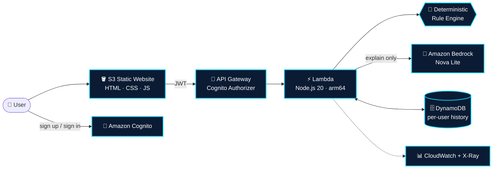
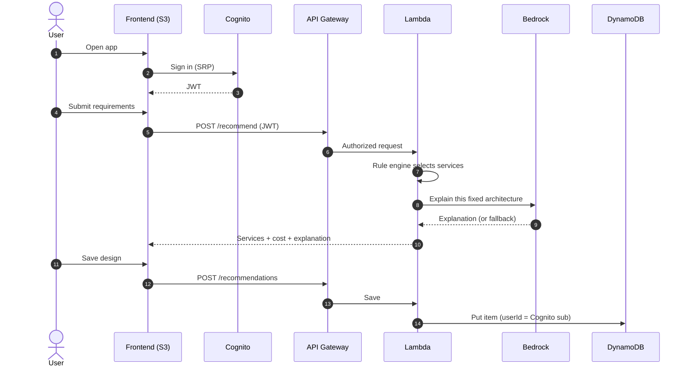

[Uploading README (10).md…]()
<div align="center">


<a href="https://git.io/typing-svg">
  
</a>

<br/>


**An authenticated web app that turns application requirements into an explainable AWS architecture.**
Deterministic rules choose the services. Amazon Bedrock only explains the decision, and never changes it.

[Quick Start](#-quick-start) · [Features](#-features) · [Architecture](#-system-architecture) · [Rule Engine](#-the-rule-engine) · [API](#-api-reference) · [Roadmap](#-roadmap)

</div>

---

## 🌌 Preview

<div align="center">

<!-- Replace these with your real screenshots / GIF (put them in /docs/media) -->


<br/><br/>

| Architecture Studio | Interactive Graph | Service Inspector |
|:---:|:---:|:---:|
|  |  |  |

</div>

> 💡 **Tip:** Record a 10-second GIF of the hero page and the graph (ScreenToGif / Kap / LICEcap) and save it as `docs/media/demo.gif`. A GIF on top of a README roughly doubles engagement.

---

## ✨ Features

| | Capability | Details |
|---|---|---|
| 🧠 | **Deterministic recommendation engine** | Same input always gives the same architecture. Fully unit-tested, no AI guesswork in service selection. |
| 🤖 | **Bedrock explanation layer** | Amazon Nova Lite explains *why* the services fit, in beginner-friendly language, with a graceful offline fallback. |
| 🌐 | **Interactive architecture graph** | Click nodes to inspect decisions, drag to pan, scroll to zoom, export as **SVG** or **PNG**. |
| 🧊 | **3D-style premium UI** | Floating cloud hologram, orbital rings, parallax service nodes, glassmorphism panels, dark theme. |
| 🔐 | **Secure by default** | Cognito sign-up, email verification and sign-in. API Gateway protected by a Cognito authorizer. |
| 💾 | **Per-user history** | Saved designs stored in DynamoDB and isolated by user ID, with encryption at rest and point-in-time recovery. |
| 🌳 | **Decision tree and health checks** | See which rule fired and which engineering checks apply to your requirements. |
| 💲 | **Qualitative cost category** | Low / Medium / High planning indicator. It is not a price quote. |
| 🚀 | **One-command deploy** | Bash and PowerShell scripts deploy the stack, inject generated IDs into the frontend and upload it to S3. |
| 🛡️ | **Graceful degradation** | If Bedrock is unavailable, the app still works and shows a built-in explanation. |

---

## 🏗️ System Architecture



### Request flow



---

## 🧠 The Rule Engine

The engine in [`backend/recommendationEngine.js`](backend/recommendationEngine.js) is the single source of truth. **Bedrock never adds, removes or replaces a service.**

| Requirement | Rule |
|---|---|
| **Always** | `S3` + `API Gateway` + `CloudWatch` |
| Users ≤ 10,000 (small) | `Lambda` |
| Users ≤ 100,000 (medium) | `Lambda` + `CloudFront` |
| Users > 100,000 (large) | `Fargate` + `Application Load Balancer` + `CloudFront` |
| Database = Relational | `RDS / Aurora` (Multi-AZ advised when high availability is chosen) |
| Database = NoSQL | `DynamoDB` |
| Authentication enabled | `Cognito` |
| High availability | `CloudFront` + `Route 53` |
| **Always (last)** | `Bedrock`, used for the explanation only |

**Cost category.** A weighted score over traffic, database type, availability, authentication and budget priority maps to `Low` (≤ 2), `Medium` (3 to 5) or `High` (6+).

**Trade-off detection.** For example, a *low budget* paired with *large traffic* raises a warning note.

---

## ⚡ Quick Start

### Prerequisites

- [AWS CLI](https://docs.aws.amazon.com/cli/latest/userguide/getting-started-install.html), configured (`aws configure` or SSO)
- [AWS SAM CLI](https://docs.aws.amazon.com/serverless-application-model/latest/developerguide/install-sam-cli.html)
- [Node.js 20+](https://nodejs.org/) and npm
- IAM permissions for CloudFormation, Lambda, API Gateway, Cognito, DynamoDB, S3, IAM roles and Bedrock invoke
- *(Optional)* Amazon Nova Lite access in your region. Without it, the fallback explanation is used.

### 🍎 macOS / 🐧 Linux

```bash
git clone https://github.com/<your-username>/CloudArchitect-AI.git
cd CloudArchitect-AI

chmod +x scripts/deploy.sh
./scripts/deploy.sh cloudarchitect-ai
```

### 🪟 Windows (PowerShell)

```powershell
git clone https://github.com/<your-username>/CloudArchitect-AI.git
cd CloudArchitect-AI

.\scripts\deploy.ps1 -StackName cloudarchitect-ai -Region us-east-1
```

The script will:

1. ✅ Install backend dependencies and run the unit tests
2. ✅ Validate, build and deploy the SAM stack
3. ✅ Read the CloudFormation outputs and write them into `frontend/config.js`
4. ✅ Sync the frontend to the S3 website bucket
5. ✅ Print your **Frontend URL** 🎉

### 🔧 Manual deployment

```bash
npm --prefix backend install --omit=dev
node backend/recommendationEngine.test.js
sam validate
sam build
sam deploy --guided
```

Then copy the stack outputs (`Region`, `UserPoolId`, `UserPoolClientId`, `ApiUrl`) into `frontend/config.js` and sync `frontend/` to the `FrontendBucketName` bucket.

### 🧪 Run the tests

```bash
node backend/recommendationEngine.test.js
```

### 🧹 Tear down

```bash
sam delete --stack-name cloudarchitect-ai
```

> The frontend bucket must be emptied before the stack can be deleted.

---

## 🎬 Demo Walkthrough

1. **Create an account**, verify your email, then sign in.
2. **Describe the workload:** application type, expected users, budget, database, availability, authentication.
3. Click **Generate architecture**.
4. Explore the **interactive graph**, the **decision tree**, the **health checklist** and the **service cards**.
5. Read the **Bedrock explanation** and the design trade-offs.
6. **Save** the design, then open **History** to see your private, persisted designs.
7. Export the graph as **SVG** or **PNG**.

---

## 🔌 API Reference

All routes require a Cognito JWT in the `Authorization` header.

| Method | Endpoint | Description |
|---|---|---|
| `POST` | `/recommend` | Run the rule engine and return services, cost category and explanation |
| `POST` | `/recommendations` | Save a generated recommendation for the signed-in user |
| `GET` | `/recommendations?limit=20` | List saved recommendations (newest first, max 50) |

<details>
<summary><b>📥 Example request</b></summary>

```json
POST /recommend
{
  "applicationType": "ecommerce",
  "expectedUsers": 50000,
  "budget": "medium",
  "database": "relational",
  "availability": "high",
  "authentication": true
}
```

</details>

<details>
<summary><b>📤 Example response (trimmed)</b></summary>

```json
{
  "recommendationId": "b3c1…",
  "trafficClass": "medium",
  "costCategory": "High",
  "services": [
    "Amazon S3", "Amazon API Gateway", "Amazon CloudWatch", "AWS Lambda",
    "Amazon RDS / Aurora", "Amazon Cognito", "Amazon CloudFront",
    "Amazon Route 53", "Amazon Bedrock"
  ],
  "explanation": { "source": "Amazon Bedrock", "text": "…" }
}
```

</details>

---

## 📁 Project Structure

```text
CloudArchitect-AI/
├── 📄 template.yaml                  # SAM / CloudFormation infrastructure
├── 📂 backend/
│   ├── app.js                        # Lambda handler: routes, Bedrock, DynamoDB
│   ├── recommendationEngine.js       # Deterministic rule engine
│   ├── recommendationEngine.test.js  # Unit tests
│   └── package.json
├── 📂 frontend/
│   ├── index.html                    # Architecture Studio UI
│   ├── styles.css                    # Premium dark / 3D-style theme
│   ├── app.js                        # Auth, graph, inspector, export
│   └── config.js                     # Generated at deploy time
└── 📂 scripts/
    ├── deploy.sh                     # macOS / Linux deployment
    ├── deploy.ps1                    # Windows deployment
    └── write_config.py               # Injects stack outputs into config.js
```

---

## 🛡️ Security Notes

| Area | Current state |
|---|---|
| Authentication | Cognito user pool with email verification and SRP auth flow |
| Authorization | Cognito authorizer on every API route; data keyed by Cognito `sub` |
| Data at rest | DynamoDB SSE enabled, point-in-time recovery enabled |
| Input handling | Server-side normalization and clamping of every input |

**Before going to production, harden these demo defaults:**

- [ ] Restrict `ALLOWED_ORIGIN` and API CORS from `*` to your real domain
- [ ] Serve the frontend through **CloudFront + HTTPS** (the S3 website endpoint is HTTP only)
- [ ] Scope the Bedrock IAM policy to the specific model ARN
- [ ] Add WAF and API throttling or usage limits
- [ ] Pin the Cognito script (`amazon-cognito-identity-js`) with SRI or bundle it locally

---

## 🗺️ Roadmap

- [ ] Export architecture as CloudFormation / Terraform starter templates
- [ ] Pricing Calculator integration for real cost ranges
- [ ] Well-Architected Framework scoring
- [ ] Compare two designs side by side
- [ ] Multi-region and disaster-recovery patterns
- [ ] CI/CD with GitHub Actions

---

## ⚠️ Important Note

CloudArchitect AI is an **educational architecture recommendation prototype**, not a production infrastructure generator. It *recommends* an architecture. It does **not** provision the recommended RDS, Fargate, CloudFront or other services for your hypothetical application. Always validate security, quotas, compliance, resilience and cost before production use.

---

## 🤝 Contributing

Contributions, issues and feature requests are welcome.

1. Fork the repository
2. Create a branch: `git checkout -b feature/amazing-idea`
3. Commit: `git commit -m "feat: add amazing idea"`
4. Push and open a Pull Request

---

## 👥 Team

Built by **CloudCrafters**.

<!-- Replace with real names / GitHub handles -->
| Name | Role | GitHub |
|---|---|---|
| Your Name | Developer | [@your-handle](https://github.com/your-handle) |

---

## 📄 License

Released under the [MIT License](LICENSE).

<div align="center">

<br/>

**If this project helped you, please consider giving it a ⭐**


</div>
